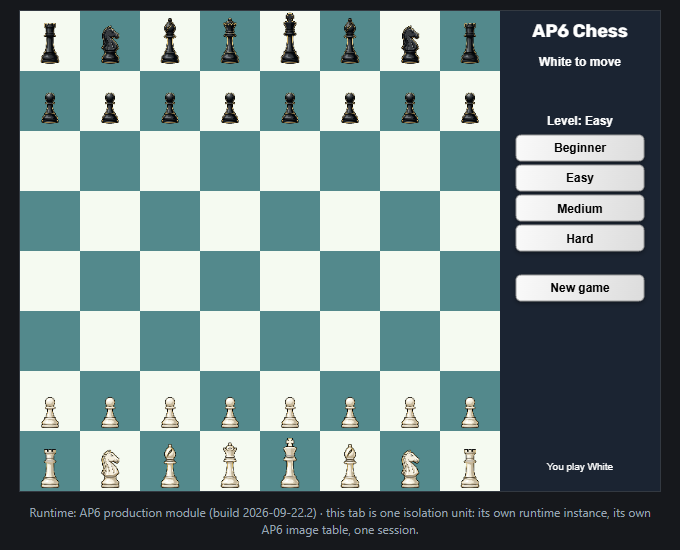

# AP6

AP6 is an application platform with one C++ core. The same application runs in the browser (WebAssembly) and natively on the desktop.

Applications are written in the **AP6 Language** and delivered as compact binary packages. The core draws everything itself on its own canvas: forms, data grids, editors, games and 3D scenes.

## Live demos

Open them in the browser, no install: **https://ap6software.com/apps/**

| Application | What it shows | Open | AP6 Language source |
|---|---|---|---|
| AI Academy | An interactive e-learning course with lessons and examples | [open](https://ap6software.com/apps/launch?id=edu.academy) | |
| AWS Developer Academy | A course on AWS development | [open](https://ap6software.com/apps/launch?id=edu.academy.aws) | |
| AWS Developer Labs | Hands-on labs for the AWS course | [open](https://ap6software.com/apps/launch?id=edu.academy.aws-labs) | |
| Claude API in C# | A course on calling the Claude API from C# | [open](https://ap6software.com/apps/launch?id=edu.academy.claude-api) | |
| Editor | A form and application editor | [open](https://ap6software.com/apps/launch?id=demo.editor) | |
| AP6 Gallery | A 3D picture gallery | [open](https://ap6software.com/apps/launch?id=demo.room) | |
| Chess | Chess against the computer | [open](https://ap6software.com/apps/launch?id=game.chess) | [examples/chess](examples/chess) |
| GAME1 | A small game | [open](https://ap6software.com/apps/launch?id=game.game1) | [examples/game1](examples/game1) |

## Pictures

**AI Academy**: lessons with the AP6 Helper, in English, Hebrew and Russian

**Chess**: four levels, played against the computer

**AP6 Gallery**: a 3D room with framed pictures

## What is in this repository
- This page and the pictures above. Short videos of the demos will follow.
- [examples/](examples): the **AP6 Language** source of demo applications, for reading. See [examples/README.md](examples/README.md).
- No source code of the AP6 core, compiler or hosts. AP6 is proprietary; see LICENSE.md.

## Contact
- Site: https://ap6software.com/
- LinkedIn: https://www.linkedin.com/company/as-software-israel
