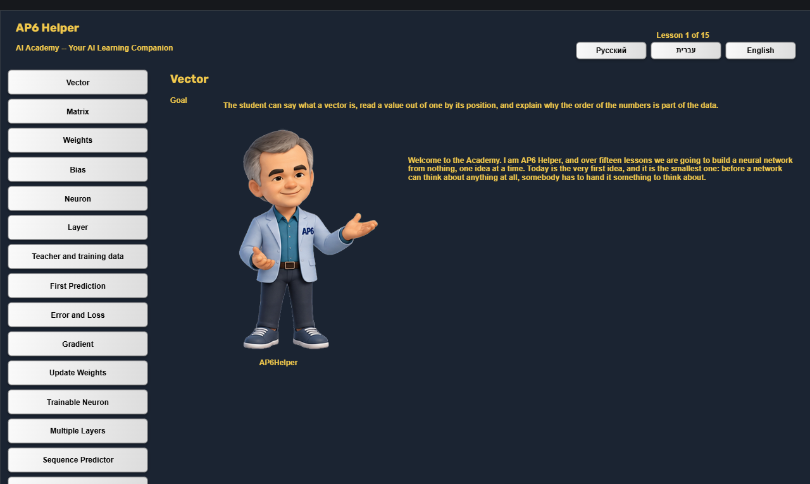
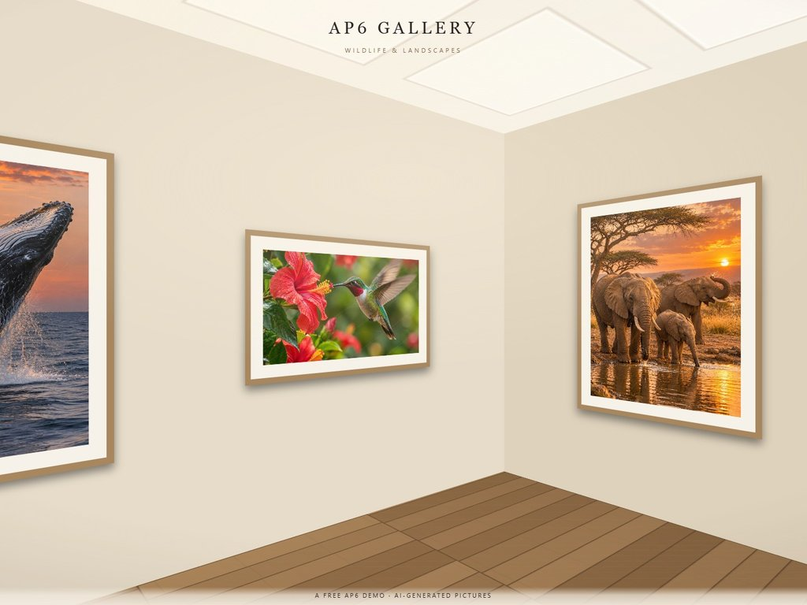

# AP6

AP6 is an application platform with one C++ core. The same application runs in the browser (WebAssembly) and natively on the desktop.

Applications are written as AP6 programs and delivered as compact binary packages. The core draws everything itself on its own canvas: forms, data grids, editors, games and 3D scenes.

## Live demos

Open them in the browser, no install: **https://ap6software.com/apps/**

| Application | What it shows |
|---|---|
| AI Academy | An interactive e-learning course with lessons and examples |
| AWS Developer Academy | A course on AWS development |
| AWS Developer Labs | Hands-on labs for the AWS course |
| Claude API in C# | A course on calling the Claude API from C# |
| Editor | A form and application editor |
| AP6 Gallery | A 3D picture gallery |
| Chess | Chess against the computer |
| GAME1 | A small game |

## Pictures

**AI Academy**: lessons with the AP6 Helper, in English, Hebrew and Russian

**Chess**: four levels, played against the computer

**AP6 Gallery**: a 3D room with framed pictures

## What is in this repository
- This page and the pictures above. Short videos of the demos will follow.
- No source code. AP6 is proprietary; see LICENSE.md.

## Contact
- Site: https://ap6software.com/
- LinkedIn: https://www.linkedin.com/company/as-software-israel
